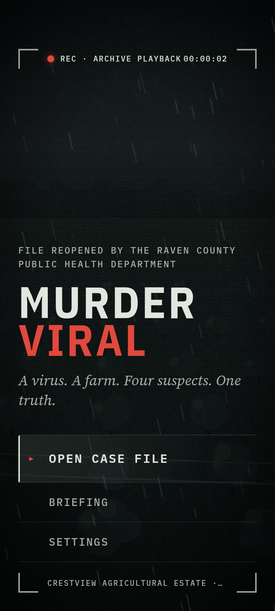
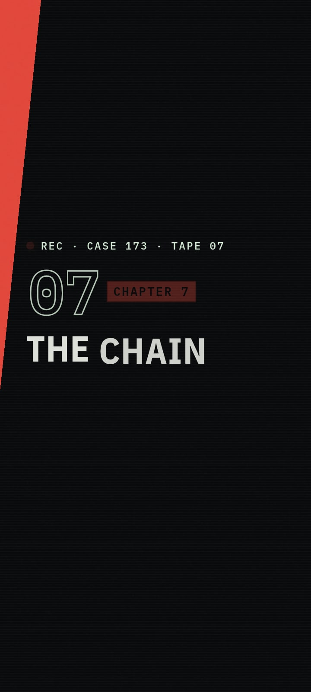
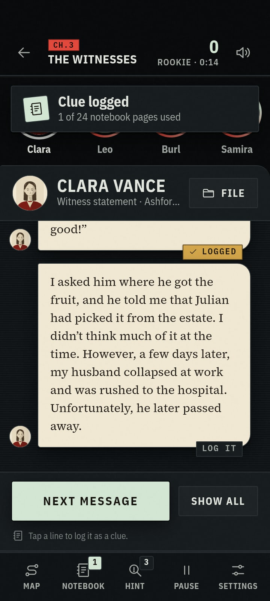
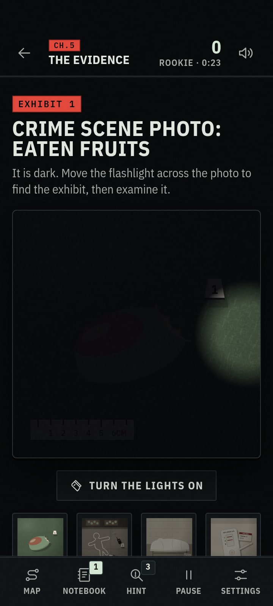
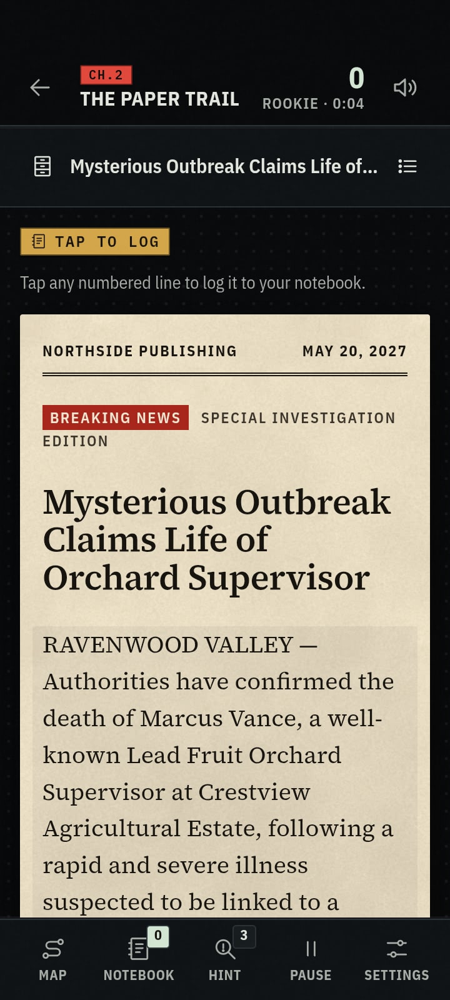
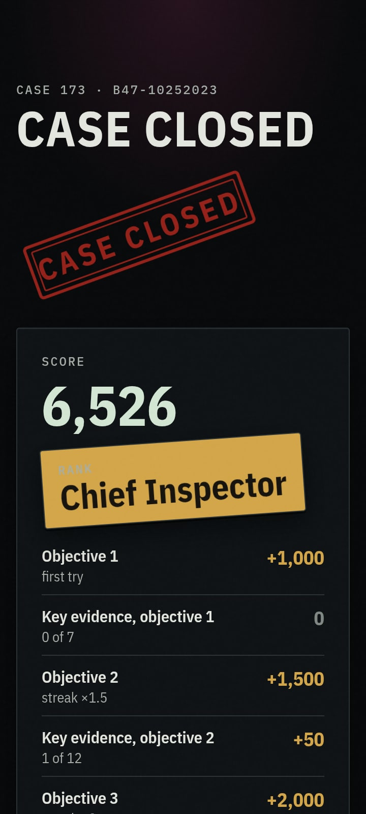

# MURDER VIRAL: Case 173 · Android

A public health detective game for Android phones.

File **B47-10252023** is reopened. Marcus Vance, lead fruit orchard supervisor at Crestview Agricultural Estate,
collapsed at work and died in hospital, and the police closed the case with no charges. You are the investigator.
Read the paper trail, play back every witness and person-of-interest statement, search the evidence photos by
flashlight, and crack three sealed objectives. Each answer is locked in an envelope that only opens once you commit.

Reviewed like archived surveillance footage and a case file, with an original adaptive true-crime score that is
generated live (no audio files), nine chapters, a stopwatch, streaks, ranks and achievements.

**Fully offline.** No account, no ads, no analytics, no network requests.

<table>
  <tr>
    <td align="center"> Title screen</td>
    <td align="center"> Chapter card</td>
    <td align="center"> Interview transcript</td>
  </tr>
  <tr>
    <td align="center"> Evidence search by flashlight</td>
    <td align="center"> The paper trail</td>
    <td align="center"> Case closed</td>
  </tr>
</table>

Screenshots from a real phone (Infinix SMART 9, Android 14).

## Download
**[murder-viral-1.0.0.apk](https://github.com/astaboyyye/MurderViral-Android/releases/download/v1.0.0/murder-viral-1.0.0.apk)** (3.5 MB) · all versions on the [Releases page](https://github.com/astaboyyye/MurderViral-Android/releases)

1. Open the downloaded APK on your phone.
2. If Android asks, allow installs from that app (your browser or file manager) for this one install.
3. Tap **Install**, then **Open**.

Updates install over the old version and keep your saved investigation (every release is signed with the same key).

| | |
|---|---|
| Requires | Android 7.0 or newer |
| Screen | Portrait, full screen |
| Size | 3.5 MB |
| Version | 1.0.0 |
| SHA-256 | `f9f2d3f591c941fdd270925e304234d7ab336f864aa320df676e2598d8af238e` |

## Other versions
- **Windows**: [MurderViral-Windows](https://github.com/astaboyyye/MurderViral-Windows) (installer, MSI or portable exe)
- **Web**: play in the browser at [murderviral.astasolutions.my](https://murderviral.astasolutions.my); it installs as an app and works offline

## Credits
Game, art, sound and music are original. Fonts: Source Serif 4, IBM Plex Sans Condensed and IBM Plex Mono
(SIL Open Font License). Animation: GSAP (GreenSock Standard "no charge" license).

© 2026 astaboyyye. All rights reserved.
